  

  
  
  

  

  

  

  

  

  <a href="https://www.sahityathakurela.in">Website</a> ·
  <a href="https://www.linkedin.com/in/sahitya-thakurela-9b6b4b368/">LinkedIn</a> ·
  <a href="mailto:thakurela.sahitya@gmail.com">Email</a>

<!-- Cards are generated by scripts/render_readme_cards.py. -->
